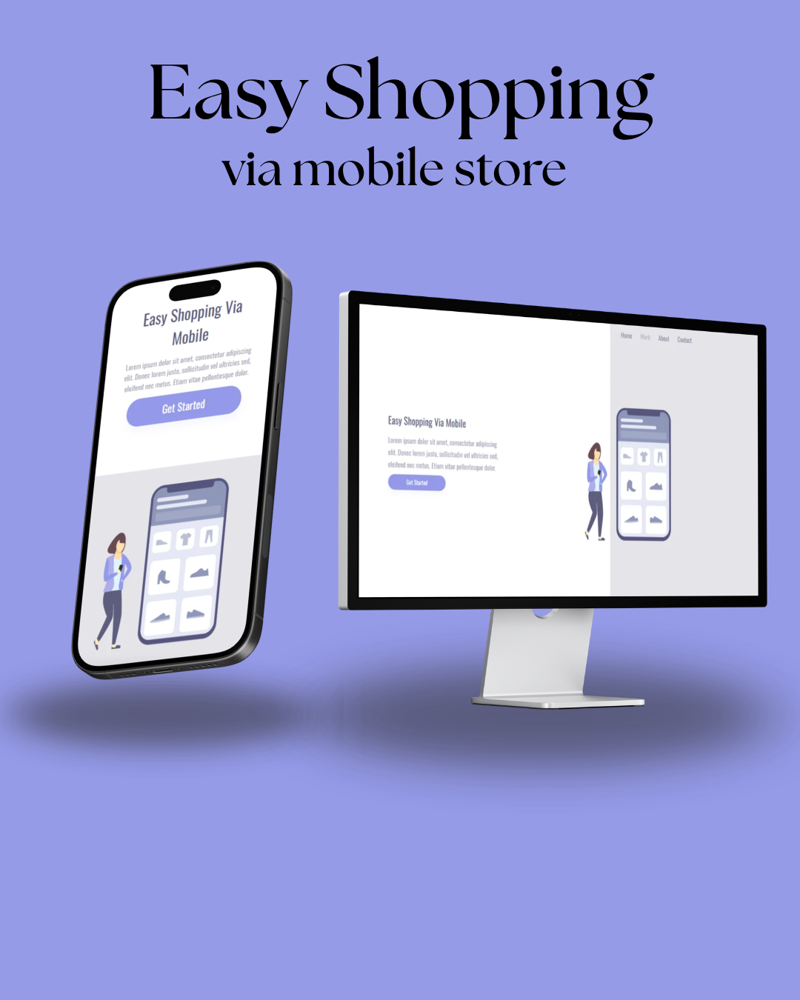

# Easy Shopping #
### Meu primeiro contato com desenvolvimento de responsividade.

 

### Tecnologias Utilizadas: 

 

 

 

### Descrição do Projeto 

Este foi um dos meus primeiros projetos de desenvolvimento web com foco em responsividade, desenvolvido durante meus estudos no DevClub.
O projeto consiste em uma página de apresentação para uma experiência de compras via dispositivos móveis, com uma interface simples e elementos visuais organizados para diferentes tamanhos de tela.

 

### 💻 O que pratiquei neste projeto 

- Estruturação de páginas utilizando HTML.
- Estilização de elementos com CSS.
- Utilização de propriedades de posicionamento e dimensionamento.
- Aplicação de Media Queries para adaptação a diferentes tamanhos de tela.
- Personalização de elementos visuais, botões, textos e imagens.

 

### 📱 Responsividade 

O projeto conta com ajustes de layout para telas menores, utilizando Media Queries para adaptar a disposição dos elementos e melhorar a visualização em dispositivos móveis.

 

### 🎯 Objetivo 

Este projeto faz parte da minha jornada de aprendizado em desenvolvimento web e representa uma etapa importante na construção dos meus conhecimentos em HTML e CSS.
Cada projeto é uma oportunidade de praticar, aprender e evoluir como desenvolvedor.

### "Não existe almoço grátis"
